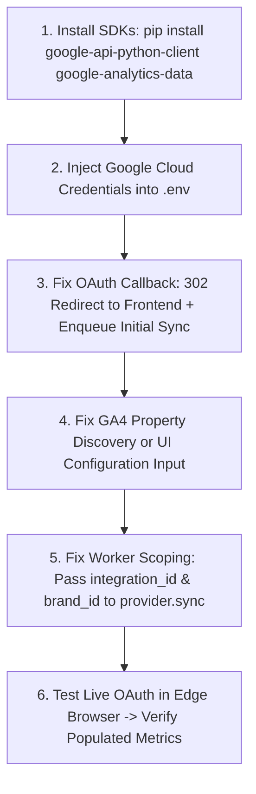

# STANDBHARAT — PHASE 28: GA4 & GOOGLE SEARCH CONSOLE INTEGRATION READINESS AUDIT

**Audit Date:** October 11, 2026  
**Status:** AUDIT COMPLETE — IMPLEMENTATION GAPS IDENTIFIED  
**Code Modifications in this Phase:** NONE (Audit-only constraint enforced)  

---

## 1. Executive Summary

This audit assesses the end-to-end readiness of StandBharat's **Google Analytics 4 (GA4)** and **Google Search Console (GSC)** integrations across backend endpoints, provider services, data models, Celery workers, and the frontend Integration Hub.

### Overall Readiness Verdict: PARTIALLY IMPLEMENTED (NOT READY FOR LIVE DATA)
- **Architecture & Security:** Strong foundation. HMAC-signed CSRF state, Fernet token encryption at rest, tenant isolation by workspace and brand, and graceful configuration degradation are fully implemented and verified with passing unit tests (`test_oauth.py` 6/6 passed, `test_dashboard.py` 7/7 passed).
- **Critical Blockers to Live Data:**
  1. **Missing Python Dependencies:** `google-api-python-client` and `google-analytics-data` are **not installed** in the environment. Attempting to sync either provider immediately crashes with `ModuleNotFoundError`.
  2. **GA4 Missing Property ID Discovery:** `GA4Provider.sync()` requires `integ.config["property_id"]`. OAuth only grants account access; there is currently no UI field or Admin API endpoint to select or input a property ID. Sync fails immediately with `"No GA4 property_id configured"`.
  3. **OAuth Callback Browser Redirect:** `oauth_callback` returns a raw JSON payload (`{"status": "SUCCESS"}`) rather than an HTTP 302 redirect back to the frontend (`/app/integrations`).
  4. **No Auto-Sync on OAuth Connect:** Connecting via OAuth sets `status="CONNECTED"`, but does not enqueue `sync_integration_task`. The integration remains without metrics (`NO_DATA`) until manually triggered.
  5. **Worker Multi-Brand Scoping:** `sync_integration_task` calls `provider.sync(str(run.workspace_id))`, which filters `Integration` by `workspace_id` rather than `brand_id` or `integration.id`, creating a cross-brand collision risk in multi-brand workspaces.

---

## 2. Detailed Technical Inspection

### 2.1. OAuth Routes, Callback, Scopes, and Token Lifecycle
- **Routes:**
  - `GET /api/integrations/{id}/oauth/login`: Validates provider, constructs HMAC-signed `state`, and returns `{ "authorization_url": ... }`.
  - `GET /api/integrations/oauth/callback`: Validates state signature, exchanges code via `google_auth_oauthlib.flow.Flow`, encrypts tokens, and upserts `Integration`.
  - `POST /api/integrations/{id}/disconnect`: Deletes the `Integration` row from the database.
- **Scopes Requested:**
  - **GA4:** `https://www.googleapis.com/auth/analytics.readonly`
  - **GSC:** `https://www.googleapis.com/auth/webmasters.readonly`
- **Token Storage & Encryption:**
  - Tokens (`token`, `refresh_token`, `token_uri`, `client_id`, `client_secret`, `scopes`) are encrypted using Fernet (AES-128-CBC + HMAC-SHA256 authenticated encryption) derived via PBKDF2 (100,000 iterations) from `SECRET_KEY`.
  - Encrypted ciphertext is stored in `Integration.credentials_encrypted`. Plaintext tokens are never written to disk or logs.
- **Refresh Token Behavior:**
  - Login initiates with `access_type='offline'` and `prompt='consent'`, guaranteeing Google returns a `refresh_token`.
  - `GA4Provider.refresh()` and `GSCProvider.refresh()` are stubs returning `True`.
  - When credentials expire, `google.oauth2.credentials.Credentials` automatically requests a new access token in-memory using `refresh_token`, but the updated token is not written back to `Integration.credentials_encrypted`.

---

### 2.2. Provider Implementations and Metrics Mapping

#### GA4Provider (`backend/app/integrations/providers/ga4.py`)
- **Query Structure:** Requests last 30 days via `BetaAnalyticsDataClient.run_report`.
  - Dimensions: `date`, `sessionSource`, `sessionMedium`, `landingPage`.
  - Metrics: `sessions`, `activeUsers`, `screenPageViews`, `engagementRate`, `conversions`.
- **Model Mapping (`TrafficMetrics`):**
  - Mapped fields: `workspace_id`, `brand_id`, `date`, `source`, `medium`, `landing_page`, `sessions`, `active_users`, `pageviews`, `engagement_rate`, `conversions`.
  - Unique Constraint: `uq_traffic_metrics` on `(brand_id, date, source, medium, campaign, landing_page)`.
  - Note: GA4 dimension list does not include `sessionCampaignName`, so `campaign` is stored as `None`.
- **Gaps:**
  - Requires `integ.config["property_id"]`. Fails if missing.
  - Python import `from google.analytics.data_v1beta import BetaAnalyticsDataClient` fails because `google-analytics-data` is not installed.

#### GSCProvider (`backend/app/integrations/providers/gsc.py`)
- **Query Structure:** Requests last 30 days via `service.searchanalytics().query`.
  - Dimensions: `query`, `page`, `date` (rowLimit: 5000).
- **Auto-Discovery:**
  - If `siteUrl` is not in `integ.config`, GSC calls `service.sites().list()` and automatically selects the first verified site, saving it into `integ.config["siteUrl"]`.
- **Model Mapping (`SearchMetrics`):**
  - Mapped fields: `workspace_id`, `brand_id`, `date`, `query`, `page`, `clicks`, `impressions`, `ctr`, `position`.
  - Unique Constraint: `uq_search_metrics` on `(brand_id, date, query, page)`.
- **Gaps:**
  - Python import `from googleapiclient.discovery import build` fails because `google-api-python-client` is not installed.

---

### 2.3. Celery Tasks & Scheduling
- **Task Definition:** `@celery_app.task(bind=True, max_retries=3) def sync_integration(self, sync_run_id_str: str)`.
- **Sync Tracking:** Uses `IntegrationSyncRun` model with statuses: `QUEUED` -> `RUNNING` -> `COMPLETED` / `FAILED`.
- **Failure States:**
  - If provider throws an exception, `IntegrationSyncRun.status = "FAILED"`, `Integration.status = "ERROR"`, and `Integration.last_error = str(e)`.
- **Gaps:**
  - **No Beat Schedule:** `celery_app.conf.beat_schedule` only contains `orchestrator-tick-every-15-minutes`. There is no recurring cron or periodic sync task for GA4 or GSC.
  - **No Auto-Trigger on Connect:** OAuth callback finishes without enqueueing `sync_integration_task.delay()`.
  - **No Rate Limiting:** No token bucket or Redis-backed rate limiter on Google API calls (GSC quota: 1,200 QPM; GA4 quota: property token limits).
  - **Multi-Brand Filtering Bug:** In `worker.py`, `provider.sync(str(run.workspace_id))` passes only `workspace_id`. Inside `ga4.py` and `gsc.py`, queries execute `db.query(Integration).filter(Integration.workspace_id == workspace_id, Integration.provider == self.provider_id).first()`. In workspaces with multiple brands, this resolves to whichever brand integration was created first.

---

### 2.4. Integration Status Logic vs Data Synchronization

| System Layer | Authenticated (No Data Yet) | Synchronized (Has Records) | Disconnected |
| :--- | :--- | :--- | :--- |
| **`Integration.status` (DB)** | `CONNECTED` (`last_sync_at=None`) | `CONNECTED` (`last_sync_at=timestamp`) | Record Deleted or `NOT_CONFIGURED` |
| **`IntegrationSyncRun`** | N/A (or `QUEUED` / `RUNNING`) | `COMPLETED` (`records_processed > 0`) | N/A |
| **Dashboard / Analytics API** | `NO_DATA` | `AVAILABLE` | `NOT_CONFIGURED` |
| **Dedicated Analytics UI** | Truthful Awaiting Data state | Full Metric Charts & Tables | Prominent Connect Banner |

**Finding:** The API and frontend layers correctly decouple authentication state (`CONNECTED`) from data synchronization state (`NO_DATA` vs `AVAILABLE`). Never fabricates mock metrics in API mode.

---

### 2.5. Security, Tenant Isolation, and Production Configuration

1. **OAuth State & CSRF Protection:**
   - State format: `"{workspace_id}:{brand_id}:{integration_id}:{hmac_sha256_signature}"`.
   - Verified via `hmac.compare_digest`. Tampered or crossed states are rejected with HTTP 403.
   - Recommended Hardening: Add a timestamp and random nonce into the state payload to prevent replay within the OAuth code validity window.
2. **Secret Handling:**
   - Credentials read from `.env` via `pydantic_settings`.
   - Missing credentials cause clean HTTP 500 error messages without server crashes.
3. **Redirect URI Requirements:**
   - Local: `http://localhost:8000/api/integrations/oauth/callback`.
   - Production: Must be a registered public HTTPS URI (e.g., `https://api.standbharat.com/api/integrations/oauth/callback`).
   - Callback currently terminates on raw JSON. Must be updated to redirect to `FRONTEND_URL/app/integrations`.

---

### 2.6. User Workflow in `/app/integrations`

The current user journey for connecting Google providers:
1. Workspace owner visits `/app/integrations`.
2. Locates **Google Analytics 4** or **Google Search Console** card.
3. Clicks **Connect**.
4. Frontend requests `/api/integrations/{id}/oauth/login`.
   - *If credentials missing in `.env`:* Displays banner `"Action Required: Google OAuth configuration is missing (GOOGLE_CLIENT_ID or GOOGLE_CLIENT_SECRET not set)"`.
   - *If configured:* Redirects browser to Google's consent screen.
5. User logs in to Google and grants read-only permission.
6. Google redirects browser to `http://localhost:8000/api/integrations/oauth/callback?code=...&state=...`.
7. **Current User Experience Friction:**
   - The user's browser lands on a raw JSON backend response (`{"status": "SUCCESS", "message": "Successfully connected"}`).
   - The user must manually navigate back to `http://localhost:3000/app/integrations`.
   - The status shows `Connected`, but no data is present until the user clicks **Sync**.
   - For GA4: Clicking **Sync** will fail with `"No GA4 property_id configured"` because there is no UI step to choose the GA4 Property.

---

## 3. Environment Package Audit

Ran python dependency inspection:
```text
google: INSTALLED
google_auth_oauthlib: INSTALLED (1.5.0)
google.oauth2: INSTALLED (google-auth 2.58.0)
googleapiclient: MISSING (No module named 'googleapiclient') -> Requires: google-api-python-client
google.analytics.data_v1beta: MISSING (No module named 'google.analytics') -> Requires: google-analytics-data
```

---

## 4. Required Google Cloud Configuration

To enable live Google OAuth and API calls:
1. **Google Cloud Project:** Create or select a project in [Google Cloud Console](https://console.cloud.google.com).
2. **Enable Required APIs:**
   - `Google Search Console API` (`searchconsole.googleapis.com`)
   - `Google Analytics Data API` (`analyticsdata.googleapis.com`)
   - `Google Analytics Admin API` (`analyticsadmin.googleapis.com`) *(recommended for property auto-discovery)*
3. **OAuth Consent Screen:**
   - User Type: External.
   - Add Test Users (emails of users who will authenticate).
   - Scopes:
     - `https://www.googleapis.com/auth/analytics.readonly`
     - `https://www.googleapis.com/auth/webmasters.readonly`
4. **OAuth 2.0 Client ID:**
   - Application Type: **Web application**.
   - Authorized Javascript Origins:
     - `http://localhost:3000`
     - `http://localhost:8000`
   - Authorized Redirect URIs:
     - `http://localhost:8000/api/integrations/oauth/callback`
5. **Environment Configuration (`.env`):**
   ```env
   GOOGLE_CLIENT_ID="<your-google-client-id>.apps.googleusercontent.com"
   GOOGLE_CLIENT_SECRET="<your-google-client-secret>"
   OAUTH_REDIRECT_URI="http://localhost:8000/api/integrations/oauth/callback"
   ```

---

## 5. Shortest Safe Path to Real Data

When ready to implement Phase 29 / Live Integration, the minimal sequence of changes is:



1. **Install SDK Packages:**
   `pip install google-api-python-client google-analytics-data`
2. **Configure `.env`:**
   Add `GOOGLE_CLIENT_ID` and `GOOGLE_CLIENT_SECRET`.
3. **Fix Callback Redirect:**
   In `backend/app/api/endpoints/integrations.py`:
   Replace JSON return with `RedirectResponse(url="http://localhost:3000/app/integrations?connected=" + integration_id)`.
   Trigger `sync_integration_task.delay(str(run.id))` automatically upon successful connection.
4. **Resolve GA4 Property ID:**
   Either:
   - Auto-discover the first GA4 property using the Google Analytics Admin API (identical to how GSC auto-discovers `siteUrl`), OR
   - Add a GA4 property configuration dialog in `/app/integrations`.
5. **Fix Multi-Brand Scoping in Provider Sync:**
   Update `provider.sync(workspace_id, brand_id)` so queries match `Integration.brand_id == brand_id`.
6. **Add Periodic Sync to Celery Beat:**
   Add daily or 6-hour sync tasks to `celery_app.conf.beat_schedule`.
